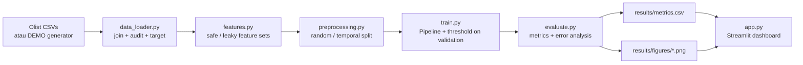

# E-commerce Delivery Delay Analysis

**Evaluasi Pengaruh Data Leakage, Ketidakseimbangan Kelas, dan Validasi Temporal terhadap Keandalan Model Prediksi Keterlambatan Pengiriman E-Commerce**

Repositori ini berisi pipeline penelitian yang dapat dijalankan ulang untuk memprediksi keterlambatan pengiriman e-commerce, dengan fokus pada tiga sumber bias yang sering membuat hasil offline terlihat lebih baik daripada kondisi deployment:

1. **Data leakage** — fitur yang baru tersedia setelah paket tiba.
2. **Ketidakseimbangan kelas** — keterlambatan adalah kelas minoritas.
3. **Validasi temporal** — random split mencampur masa lalu dan masa depan.

> **Status hasil:** kode, data DEMO, dan unit test sudah tersedia. Eksperimen model **belum dijalankan** pada sesi ini, sehingga repositori ini tidak memuat angka performa. Jalankan perintah di bawah untuk menghasilkan metrik aktual. Tidak ada angka yang dikarang di README.

---

## Research questions

- Seberapa besar metrik offline meningkat ketika fitur pasca-pengiriman dimasukkan?
- Apakah *class weighting* membantu recall kelas terlambat tanpa merusak precision?
- Seberapa jauh performa turun ketika test set berasal dari periode setelah data training?
- Apakah kesimpulan tentang model terbaik berubah antara random split dan temporal split?

## Metodologi

### Target

```
is_late = date(order_delivered_customer_date) > date(order_estimated_delivery_date)
```

Perbandingan dilakukan pada granularitas tanggal karena estimasi Olist berupa tanggal, bukan waktu. Baris tanpa tanggal pengiriman/estimasi dan baris dengan urutan waktu mustahil dibuang dan dicatat dalam audit.

### Fitur aman vs fitur bocor

| Set | Isi | Tujuan |
|---|---|---|
| `safe` | Waktu pembelian, lead time estimasi, approval delay, harga, freight, item, pembayaran, state, kategori, berat/volume | Kandidat deployment |
| `leaky` | `safe` + durasi pengiriman aktual, transit carrier, `review_score`, selisih hari | Demonstrasi optimistic bias |

`src/features.py` memblokir kolom pasca-pengiriman dari set `safe` melalui `assert_feature_safety()`.

### Model dan penyeimbangan

- Logistic Regression (`lbfgs`, maksimum 2000 iterasi)
- Random Forest (300 pohon, `min_samples_leaf=5`)
- Strategi: `none` dan `class_weight` (`balanced` / `balanced_subsample`)
- Semua imputasi, scaling, dan one-hot encoding berada di dalam `Pipeline`, sehingga hanya di-fit pada training set.
- Tidak ada SMOTE atau resampling yang membuat observasi sintetis lintas split.

### Validasi

| Strategi | Pembagian | Pertanyaan |
|---|---|---|
| `random` | Stratified 70/10/20 | Baseline optimistis |
| `temporal` | Kronologis 70/10/20 | Generalisasi ke pesanan masa depan |

Test set **tidak digunakan** untuk memilih threshold atau hyperparameter. Threshold dipilih dengan memaksimalkan F1 pada validation set; model ditandai "terbaik" berdasarkan PR-AUC validation.

### Metrik

Precision, recall, F1, PR-AUC (average precision), ROC-AUC, Brier score, confusion matrix, predicted positive rate, dan calibration curve. PR-AUC menjadi metrik utama karena kelas terlambat minoritas.

## Arsitektur



## Struktur repositori

```
ecommerce-delay-analysis-ai/
├── app.py                      # Dashboard Streamlit (7 halaman)
├── data/
│   ├── README.md               # Sumber, lisensi, definisi target
│   ├── raw/                    # Olist CSVs (tidak di-commit)
│   └── demo/                   # Demo CSV (tidak di-commit)
├── results/                    # Metrik & gambar (dihasilkan)
├── scripts/
│   ├── download_data.py        # Verifikasi / unduh via Kaggle CLI
│   ├── make_demo_data.py       # Generator data DEMO
│   └── run_experiments.py      # Orkestrasi seluruh eksperimen
├── src/
│   ├── config.py
│   ├── data_loader.py
│   ├── demo_data.py
│   ├── preprocessing.py
│   ├── features.py
│   ├── train.py
│   ├── evaluate.py
│   └── visualization.py
├── tests/                      # Unit test cepat (tanpa training panjang)
├── requirements.txt
├── pyproject.toml
└── README.md
```

## Instalasi

Python 3.10+ (diuji pada Python 3.11).

```bash
python -m venv .venv
# Windows PowerShell
.venv\Scripts\Activate.ps1
# Linux/macOS
source .venv/bin/activate

pip install -r requirements.txt
```

Jika PowerShell memblokir aktivasi, gunakan `python -m pip install -r requirements.txt` dengan Python yang sama tanpa aktivasi.

## Menjalankan

### 1. Mode DEMO (tanpa Kaggle)

```bash
python scripts/make_demo_data.py --n-orders 15000
python scripts/run_experiments.py --source demo
streamlit run app.py
```

Semua output diberi label `DEMO`. Angka dari mode ini **bukan** hasil penelitian.

### 2. Dataset Olist asli

```bash
# Letakkan CSV di data/raw/, lalu:
python scripts/download_data.py --check
python scripts/run_experiments.py --source olist
streamlit run app.py
```

Alternatif unduh dengan Kaggle CLI:

```bash
python scripts/download_data.py --download
```

Sumber dan lisensi: lihat [`data/README.md`](data/README.md).

### 3. Eksperimen lebih cepat

```bash
# Hanya fitur aman, hanya satu model, hanya validasi temporal
python scripts/run_experiments.py --source demo --skip-leaky \
  --models logistic_regression --splits temporal
```

### Perintah dashboard

```bash
streamlit run app.py
```

Dashboard tetap dapat dibuka tanpa `results/`; halaman audit data akan tampil dan halaman metrik menampilkan perintah yang perlu dijalankan.

## Output eksperimen

Setelah `run_experiments.py` selesai, folder `results/` berisi:

| File | Isi |
|---|---|
| `metrics.csv` | 16 konfigurasi (2 fitur × 2 split × 2 model × 2 strategi) |
| `summary.json` | Ringkasan yang diturunkan dari hasil aktual |
| `dataset_audit.json` | Skema, missing values, duplikasi, rentang tanggal, late rate |
| `split_summary_random.json`, `split_summary_temporal.json` | Ukuran dan late rate per partisi |
| `best_model.json` | Konfigurasi terbaik berdasarkan PR-AUC validation |
| `temporal_degradation.csv` | Selisih PR-AUC random vs temporal per konfigurasi |
| `error_by_state.csv` | False positive/negative per negara bagian |
| `predictions/best_model_test_predictions.csv` | Prediksi test untuk analisis error |
| `figures/*.png` | Distribusi kelas, missingness, timeline, perbandingan model, leakage, PR curve, calibration, threshold, error per state |

## Status verifikasi

Diperiksa pada lingkungan pengembangan (Windows, Python 3.11.9):

| Pemeriksaan | Perintah | Hasil |
|---|---|---|
| Import seluruh modul | `python -c "import app; import src..."` | Berhasil |
| Unit test | `pytest` | **44 passed** |
| Generator DEMO | `python scripts/make_demo_data.py --n-orders 600` | Berhasil, 600 baris, late rate 13,67% (sampel kecil) |
| CLI eksperimen | `python scripts/run_experiments.py --help` | Berhasil |

Eksperimen penuh **belum dijalankan**, sehingga `results/metrics.csv` dan gambar performa belum ada. Ini disengaja agar tidak ada angka yang dikarang; jalankan perintah pada bagian *Menjalankan* untuk memproduksinya.

## Pengujian

```bash
pytest
```

Test mencakup:

- definisi target pada batas tanggal,
- penanganan data kosong, duplikasi, dan timestamp mustahil,
- tidak ada kolom pasca-pengiriman pada fitur aman,
- split acak/temporal, ketiadaan overlap `order_id`, dan urutan waktu,
- imputasi serta kategori yang tidak dikenal,
- pemilihan threshold hanya dari validation set,
- perhitungan metrik, confusion matrix, dan error analysis,
- pembuatan gambar ke direktori sementara.

Test tidak menjalankan eksperimen penuh dan tidak mengunduh data.

## Catatan reproducibility

- Random seed default: `42` (`src/config.py`).
- Versi dependensi tidak dikunci ketat; gunakan `pip freeze > requirements-lock.txt` untuk arsip penelitian.
- Perangkat keras dan waktu training dicatat per konfigurasi pada kolom `fit_seconds` di `metrics.csv`.
- Hasil dapat berubah jika versi scikit-learn berubah, terutama Random Forest dan `average_precision_score`.

## Keterbatasan

- Satu marketplace, satu periode historis; belum tentu berlaku untuk logistik lain.
- Estimasi tanggal berasal dari marketplace dan dapat berubah setelah checkout.
- Target bukan SLA operasional dan tidak menangkap semua penyebab keterlambatan.
- Temporal split tunggal tidak membuktikan stabilitas musiman.
- Data katalog adalah snapshot; atribut produk dapat berubah setelah pesanan dibuat.
- Mode DEMO sepenuhnya sintetis dan tidak boleh dikutip sebagai temuan.
- Lisensi Olist (CC BY-NC-SA 4.0) membatasi penggunaan komersial.

## Lisensi

Kode: MIT (lihat `LICENSE`). Dataset Olist: CC BY-NC-SA 4.0, terpisah dari lisensi kode.

## Sitasi data

Olist. *Brazilian E-Commerce Public Dataset by Olist*. Kaggle.
https://www.kaggle.com/datasets/olistbr/brazilian-ecommerce
